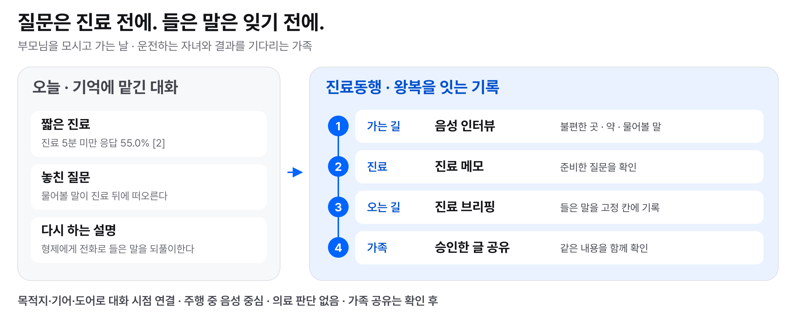
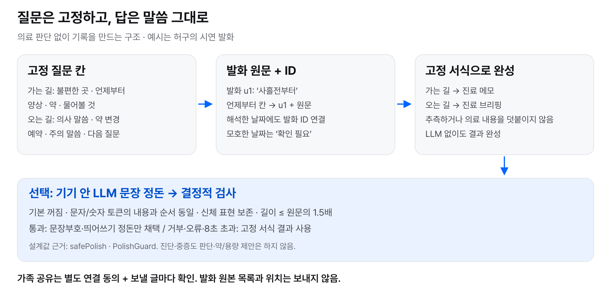

# 진료동행 — 기획서 02 앱 프로젝트 소개 / 심사 자료

> 접수양식(기획서) 02의 본문을 검토용으로 옮긴 사본이다. 제출본은 repo 루트의 `contest-application-consent.docx`이고 `python3 -I tools/plan/build_docx.py`로 다시 만든다. 내용을 고칠 때는 `tools/plan/content.py`를 고친다.

**앱명 / 프로젝트명**: 진료동행

## 1. 앱 한 줄 소개

**진료동행 · 가는 길의 질문부터 오는 길의 기록까지**

*그림 1. 오늘의 끊긴 대화를 병원 왕복의 기록으로. 문제 상황 예시와 기능 흐름도이며 효과 실측은 아니다.*

**진료동행**은 **병원 목적지·기어·도어로 대화할 때를 알고**, 가는 길의 질문부터 오는 길의 브리핑까지 **주행 중 말로 준비·기록하는** 앱이다.

## 2. 기획 배경

#### 진료실에 들어가기 전 질문이 흩어지고, 나온 뒤에는 설명을 되풀이한다

**정기 진료에 부모님을 모시고 가는 자녀**가 첫 대상이다. 부모님은 불편했던 일을 떠올리고 자녀는 운전한다. 받아 적지 못한 질문은 진료 앞에서 빠지고, 돌아오면 다른 가족에게 들은 말을 다시 설명해야 한다. **준비와 전달이 기억에만 맡겨지는 순간**을 해결하려 한다.

| 수치 | 내용 | 출처 |
|---|---|---|
| 23,048건 | 서울 병원안심동행 · 2025년 | 2021년 649건에서 증가 [1] |
| 55.0% | 외래 응답자 · 진료 5분 미만 | 2023 의료서비스 경험조사 [2] |
| 20.3% | 65세 이상 인구 · 2025년 | 통계청 고령자 통계 [4] |

**왜 지금인가.** 고령 인구와 공공 동행 이용의 배경 위에서, 짧은 진료 전에 질문을 준비하고 뒤에 설명을 이어 주는 도구를 제안한다. 질문 누락·전달 부담의 빈도와 앱 효과는 아직 측정하지 않은 고객 가설이다.

| 반복 방문과 가족의 빈자리 | 기획에 주는 의미 |
|---|---|
| 65세 이상 고혈압 외래: 남 6.8일·여 7.1일/년(2024) [7] | 해당 질환 진료자의 반복 방문 근거다. 전체 노인 평균이나 동행 횟수는 아니다. |
| 서울: 3,311명·19,201건(2024), 시간당 5,000원 [8] | 반복 이용과 비용 분담이 있는 서비스다. 인력 동행 요금을 앱 가격으로 옮기지 않는다. |
| 경기: 직장 등 가족 지원 공백도 대상 [9]; 설명 전달 지원 [6][9] | 동행 전 준비와 동행 후 가족 전달을 돕는다. 사람의 동행이나 의료 설명을 대체하지 않는다. |

출처·열람일은 7번. [1]은 한국경제 네이트 전재본 기준이다. 서울시 자료의 2021년 본문·표 수치가 달라 성장 배수는 쓰지 않는다. 이용 건수는 고유 이용자·차량 수요·MAU가 아니다.

#### 왜 차인가 · 병원 왕복에 대화의 시점을 붙인다

- **차는 병원에 가는 맥락을 안다.** 목적지·기어·도어로 준비와 귀가를 구분해 대화를 제안한다. 도착은 진료 완료의 확정이 아니다.
- **운전 중에는 말로 진행한다.** 질문을 읽고 답을 받아 기록한다. 긴 메모는 P이고 주행 제한이 풀리면 연다.
- **함께 탄 시간이 대화를 이어 줄 수 있다.** 가는 길에는 물어볼 말, 오는 길에는 들은 말을 정리한다. 이동 시간·조용함은 실측하거나 보장하지 않는다.

#### 차별점은 기록보다 병원 이동에 대화 시점을 연결하는 것

아래는 특정 제품 평가가 아닌 일반적인 수동 사용 방식과의 설계 비교다. 앱의 자동 목적지·도착 경로는 구현돼 있으나 제출 시연에서는 모의 입력이다.

| 비교 축 | 휴대폰 음성 메모 | 메신저 | 진료동행 |
|---|---|---|---|
| 시작 기억 | 직접 녹음 시작 | 직접 대화방 열기 | 병원 목적지에서 준비 제안 |
| 이동과 기록 연결 | 제목·폴더로 연결 | 대화에서 구분 | 같은 방문의 준비·귀가 연결 |
| P/D·도어 맥락 | 사용자가 판단 | 사용자가 판단 | 신호로 문 열림·귀가 구분 |
| 주행 중 상세 제한 | 사용자가 조절 | 사용자가 조절 | P와 UX 제한 해제 확인 |
| 다음 진료 재사용 | 이전 녹음 찾기 | 대화 검색 | 같은 병원 지난 질문 불러오기 |

## 3. 앱 주요 기능 및 차량 특화 요소

**병원 목적지와 기어·도어가 대화할 시점을 정하고, 주행 중 말로만 준비·기록을 마칠 수 있다.** 수동 음성 메모에는 없는 차량 신호 기반 시작 조건이다. 도착·체류는 진료 완료의 추정 조건이며 의료 판단이 아니다.

1. **현재 질문 · 화면 가운데**: 진료 메모 4/5와 약에 관한 질문. 한 번에 현재 질문을 보여 준다.
2. **대화 상태 · 질문 아래**: 캡처는 TTS가 질문하는 ‘말하는 중’. STT 준비가 끝나면 ‘듣는 중’으로 바뀐다.
3. **예 / 아니요 / 넘어가기 · 하단**: 짧은 응답 버튼. 음성으로도 답하며 모르는 질문은 넘길 수 있다.
4. **시연 표시 · 오른쪽 위와 본문**: 미리 정한 대답·가족 답장 모의를 명시한다. 실제 음성 인식의 증거가 아니다.
5. **주행 중 제한 · 화면 전체**: 긴 기록과 상세 입력을 숨긴다. P와 CarUxRestrictions 해제를 함께 확인해 연다.

*그림 2. 실제 에뮬레이터 주행 화면. 질문·대화 상태·짧은 응답만 남긴다. 대답과 가족 답장은 시연용 모의 입력이다.*

| 기능 · 사용자에게 | 차량이라서 가능한 이유 · 신호와 API |
|---|---|
| **병원 가는 길 감지** · 목적지에서 준비 제안. 직접 시작도 가능. | NaviHelper.getDestinationInfo(), DestinationInfo.name. 등록 병원·병원 이름 키워드 확인. |
| **가는 길 인터뷰** · 불편한 곳·시작 시점·양상·약·질문을 기록. STT 인식문·발화 ID 보존, 약은 읽어 확인. | Pleos TextToSpeech.speak(), SpeechToText.request(). 차의 마이크·스피커로 묻고 답한다. |
| **주행 중 짧은 화면** · 질문·대화 상태·진행도. 긴 기록은 주차 후. | CarUxRestrictions + 기어 P를 함께 확인. 신호를 모르면 제한. |
| **문 열림·합류** · 동승석 문 열림 안내, 가족의 “나왔어” 답장 읽기. 하차 확정 아님. | 내비 도착 + P + 동승석 도어. Door.registerDoorPosition(), DoorArea(ROW_1_RIGHT). 지원 영역부터 확인. |
| **오는 길 브리핑** · 들은 말·약 변경·다음 예약·주의 말씀·다음 질문 정리. | 15분 체류 후 P→D, 누적 주행 60초 뒤 제안. 기어는 pleos-kit의 AAOS CarState. |
| **가족 전달** · 보낼 글을 읽고 승인한 뒤 공유. 승인 글에 인식문 포함 가능. | 음성 확인 + FamilyLink 포트. 실제 모드는 노트북 HTTP relay 연결. |
| **정기 진료 이어 쓰기** · 지난 질문·약 변경을 재확인. 서비스 실행 중 예약일 확인. | 기기 안 방문 기록. 좌표가 저장된 병원만 NaviHelper.requestRoute(RouteInfo)로 안내. |

#### 반드시 지키는 원칙

> **의료 판단 없음.** 진단·중증도·처방·용량 조언을 만들지 않는다. STT 인식문과 발화 ID를 추적하며 인식 정확성을 보장하지 않는다. 응급 도움을 명시적으로 요청하면 고정 안내만 한다.
>
> **민감정보 별도 동의.** 인터뷰 전 동의받아 앱 전용 기기 저장소에 보관한다. 기본 180일 후 정리하며 기간 설정·전체 삭제·철회를 제공한다. 한 돌봄 대상용이고 호칭 변경은 대상 전환이 아니다. 다른 대상은 전체 삭제·새 동의 후 시작한다. [설계값: Policy·Settings]
>
> **가족 공유 별도 동의.** 연결 동의와 매번의 전송 확인을 받는다. 발화 목록·좌표는 제외하지만 승인 글에 개인정보가 포함될 수 있다. 비식별화가 아니다. 실제 모드 로컬 relay는 메모리 보관·24시간 만료다. [설계값: relay]
>
> **LLM 선택·기본 꺼짐.** 기기 내 공백 정리만 허용한다. 공백을 제외한 문자·숫자·단위·문장부호가 같고 길이는 원문의 1.5배 이하여야 한다. 거부·오류·8초 초과면 고정 서식을 쓴다. [설계값: safePolish·PolishGuard]

위 기능은 소스 구현을 기준으로 설명했다. 실제 차량·에뮬레이터 검증과 제품 확장은 5번에서 구분한다. HTTP relay는 로컬 시연용이다. 외부 배포에는 HTTPS와 사용자 인증이 필요하다.

## 4. 주요 사용 시나리오

#### 어머니 정기 진료가 있는 아침

같은 병원의 진료 전후를 한 방문 기록으로 잇는다. 아래 대화는 허구의 시연 예시다.

**그림 3. 부모님과 자녀의 병원 왕복** · 출발 전 → 가는 길 → 진료 후 정문 → 오는 길·가족

| 단계 | 차·앱이 하는 일 | 사용자가 듣고 보는 것 |
|---|---|---|
| 1. 출발 전 | 주차 화면에서 민감정보 안내·동의. 가족 연결·공유는 별도 동의. 병원 목적지로 준비를 제안한다. | 어머니와 안내를 확인한다. “오늘 꼭 물어볼 것을 먼저 정리해 두자.” |
| 2. 가는 길 | 현재 질문을 읽고 답을 칸별로 기록한다. 모르면 넘기고 약은 읽어 확인한다. | “무릎이좀아프”, “사흘전부터”. 긴 글을 열지 않고 말로 준비한다. |
| 3. 진료·정문 합류 | 도착·P 뒤 동승석 문 열림을 안내한다. 승인한 메모를 공유하고, 진료 뒤 가족의 “나왔어”를 읽는다. | 진료 때 메모의 물어볼 것을 확인한다. 끝나면 가족 화면에서 합류를 알린다. |
| 4. 오는 길·가족 | 귀가 조건 뒤 들은 말을 기록하고 약·예약을 읽어 확인한다. 승인한 브리핑만 전달한다. | “검사 결과는 다음 진료 때 같이 보자고 하셨어.” 내용을 듣고 승인해 가족과 잇는다. |

> **기억을 돕되, 사실을 대신 판단하지 않는다**
>
> **진료실을 녹음하거나 의사 말씀을 해석하지 않는다.** 돌아오는 길에 사용자가 전한 말을 기록한다. 약·예약 정정은 인터뷰 중 1회, 이후에는 확인 필요로 남긴다. 완료 후 항목별 수정은 지원하지 않는다.

문 열림은 하차·진료 완료를 확정하지 않는다. 가는 길은 누적 주행 60초 뒤, 귀가는 15분 체류·P→D 뒤 새로 누적한 주행 60초 뒤 제안한다. P이고 주행 제한이 풀리면 직접 시작할 수 있다. 운전 안전 판정이 아닌 설계값이다(Policy.SAFE_DRIVE_MS·STAY_MS).

## 5. 개발 계획

#### 판단 로직은 순수 Kotlin, 차량 연결은 pleos-kit

`VisitCore`의 단일 이벤트 큐가 상태를 소유한다. `VisitMachine`은 상태와 작업을 결정하고 먼저 저장한다. 음성·통신·LLM은 비동기로 실행하며 응답 ID를 대조한다. 삭제·철회 후 늦은 결과는 폐기한다.

| 층 | 구현 범위 |
|---|---|
| 순수 Kotlin core | 방문 상태, 원문 슬롯, 한국어 응답·날짜 해석, 동의·보관 정책, 브리핑 서식, PolishGuard. Android SDK 없이 JVM 테스트 가능. |
| 포트 | Repository · SpeechPort · FamilyLink · Polisher · Navigator. 시간은 주입한다. 파일·SDK·네트워크 없이 상태 전이를 검증한다. |
| Android app | Compose 화면 + VisitService 전경 서비스 + VoiceAgent + HttpFamilyLink. 앱은 SDK를 직접 호출하지 않고 pleos-kit을 사용한다. |
| 저장·복구 | AtomicRepository: 임시 파일 후 원자 교체. 재시작하면 진행 중 인터뷰를 주차 화면에서 이어가거나 폐기한다. 저장 실패 때 인터뷰를 멈춘다. |
| 가족 relay | Python 표준 라이브러리 HTTP 서버. 임의 토큰으로 연결하고 승인된 글과 상태만 보관한다. 만료·삭제·잘못된 요청을 검사한다. |

*그림 4. 고정 질문 → STT 인식문과 ID → 서식 기록. 선택 LLM의 공백 정리도 결정적 검사로 제한한다.*

#### 레퍼런스에서 확인한 SDK/API

| API 이름 | 용도 · 연결 방식 |
|---|---|
| NaviHelper.getDestinationInfo() / DestinationInfo.name | 목적지의 병원 이름과 좌표. pleos-kit의 NaviKit → VisitNaviKit에서 core용 값으로 변환. |
| NaviHelper.requestRoute(routeInfo: RouteInfo) | 사용자가 승인하고 저장 좌표가 있을 때 길안내. 병원 POI 검색 기능은 제공하지 않는다. |
| Door.checkDoorPositionCapabilities() / registerDoorPosition(area, listener) | DoorArea(DoorValue.ROW_1_RIGHT)의 읽기 지원을 확인한 후 동승석 도어 상태 구독. 문을 자동 조작하지 않는다. |
| SpeechToText.request() / TextToSpeech.speak(text, isFinal) | ON_DEVICE 음성 입력·출력. TTS 종료 후 STT를 시작하며 onReady 뒤에만 듣는 시간을 센다. |
| LLM.generateContent(prompt, listener) / Mode.ON_DEVICE | 선택적 공백 정리. 실패·시간 초과·원문 검사 탈락 때 서식 결과로 대체. |
| AAOS: VehiclePropertyIds.GEAR_SELECTION / PERF_VEHICLE_SPEED | pleos-kit CarState로 기어·속도 읽기. CarUxRestrictions와 독립 화면 watcher로 주행 중 상세 표시 차단. |

#### 검증과 기술 PT 시연

JVM 테스트로 수치 기호 변경 거부, 병원 변경·취소 뒤 도착 차단, 정정·재시작·귀가 대기를 확인한다. 가상 시간·이벤트 검사이며 실제 음성·내비 품질 검사는 아니다. 반례와 한계는 docs/SDK_AUDIT.md에 연결했다.

| 시연 범위 | 실제 연결과 모의 입력의 경계 |
|---|---|
| REAL | Pleos TTS SDK 요청·완료, VC의 Vehicle 도어 + AAOS 기어·속도, CarUxRestrictions 화면 제한. 무음 녹화로 실제 가청 출력 품질을 입증하지 않는다. |
| MOCK | STT 대답·병원 목적지/도착·병원 체류 및 귀가 60초 시간 이동·메모리 가족 답장. 실제 마이크·내비 도착·휴대폰 relay 왕복은 미검증이다. |

제출 APK는 2026-11-15 현재 소스로 빌드했다. 환경: Pleos Connect Emulator v2.1.0 / API 34 / 2560×1440 가로 / 160dpi. 개발자가 설치·시연을 확인했다. 영상은 인터뷰·약/예약 확인·기록·모의 가족 답장을 보여 준다.

## 6. 기대효과 및 발전 가능성

**첫 대상은 같은 부모님께 정기 동행하는 운전자다.** [3][7]은 반복 방문, [8][9]는 동행·전달 부담의 근거다. 의료 결과·시간·비용 개선은 아직 약속하지 않는다.

#### 확보 사용자 0명 · 10가구에서 시작하는 실증(PLAN)

확보 사용자·제휴·매출은 0이다. Pleos 접근 가능 운전자와 정기 동행 가구의 교집합 규모는 미확인이다. MAU는 월 1회 이상 기록 완료 운전자 수다. 미검증 보급량으로 시장 규모를 만들지 않고 첫 10가구의 월 사용·다음 진료 재사용을 측정한다.

**모집 경로(미접촉):** [5][9]의 운영망 중 평택시가족센터 등에 담당자 인터뷰·모집 협력을 제안한다. 공공 동행은 차량을 제공하지 않으므로 기관 차량 판매가 아닌 가족 모집 경로다. 협력 동의 후 같은 대상의 10가구를 모집해 허구 과제로 기존 메모·메신저와 순서를 바꾸어 비교하고, 별도 동의 아래 90일간 다음 진료 재사용을 관찰한다.

| 지표 | 통과 기준 — 모두 PLAN |
|---|---|
| 도움 없이 준비→기록 확인 | 10가구 중 8가구 이상 완료 |
| 사전 지정 질문 누락 | 기존 방식 대비 누락 감소 중앙값 1개 이상 |
| 인식 정정·확인 | 방문당 정정 요청 중앙값 2회 이하. 잘못된 약·예약의 확인 없는 확정 0건 |
| 다음 진료 재사용 | 90일 내 다음 진료 도래 가구의 60% 이상. 대상 5가구 미만이면 판정 유보 |

#### 유료화: 차량 운영 업체의 월 활성 차량 구독 가설

기관 도입은 대상별 기록 분리·권한·운영 검증 후 확장한다. Pleos 차량을 운영하는 보호자 서비스 업체를 찾아 구매 담당자에게 아래 가격과 준비·가족 전달 업무를 검증할 계획이다. 공공 인력 동행 요금[8][9]은 자부담이며 앱 가격·운영 원가와 다르다. 현재 계약·지불 의향·아래 비용은 모두 미확인이다.

| 차량 1대·월 기준 | 가설과 계산 — VAT 제외, 실측 아님 |
|---|---|
| 구독료 | 20,000원 / 월 1회 이상 기록 완료 차량. 미활성 차량 과금 없음 가정 |
| 고객 지원 | 12분 × 시간당 30,000원 = 6,000원 |
| 운영·결제·도입 배분 | 보안 relay·모니터링 2,000원 + 결제 3%(600원) + 도입비 24,000원/12개월 = 2,000원 |
| 직접비 차감 후 잔액 | 20,000 − 10,600 = 9,400원(47%). 이익 확정값이 아님 |

고정 유지보수 월 1,000,000원 가정 시 위 잔액으로 해당 비용을 충당하려면 107대가 필요하다. 초기 개발·보안심사·SDK 이용료는 별도 견적이며 추가 비용 확인 시 재산정한다. 클라우드 LLM 호출비는 기본 경로에 없다. 가격은 시간당 3만원의 행정 인건비 가정에서 월 40분 절감에 해당한다. 실증의 업무시간·지원시간 기록과 구매 인터뷰로 검증한다.

병원 예약 연동·보호자 앱·지자체 B2G는 확장 계획이다. 운영기관은 먼저 실증 협력 후보이며 다인 대상 분리·인증·접근 통제 전에는 유료 차량 도입을 전제하지 않는다. 진료 내용의 광고·판매는 하지 않는다.

## 7. 참고자료

**구현 자료와 화면** · 여정 비교도·인터뷰 구조도, 구현·테스트와 실제 에뮬레이터 캡처를 함께 제공한다.

| 자료 | 파일 · 내용 |
|---|---|
| 시연 영상 | `docs/demo/jinryo-donghaeng-demo.mp4` · 2분 35초. Pleos Connect Emulator·Virtual Console 화면 녹화와 자막, 소리 없음. 별도 동의 → 가는 길 음성 인터뷰 → P·동승석 문 열림과 진료 메모 → 가족 공유 동의 → 오는 길 브리핑 → 기록 완료와 가족 답장. |
| 실행 파일 | `apk/` 폴더의 release APK. 설치·시연 절차는 README에 안내한다. |
| 구현·구조·이용 조건 | `visit-core`, `app`, `pleos-kit`, `tools/family`, `docs/ARCHITECTURE.md`. 이용 조건과 고지는 `LICENSE`, `NOTICE.md`에 정리했다. |

#### 확인한 자료와 출처

모든 웹 자료는 2026-11-15에 본문을 실제 열람했다. 아래는 확인한 사실의 요약이며 원문을 복제하지 않았다.

| 번호 · 자료 / 게시일 | 확인한 사실 · URL |
|---|---|
| [1] 한국경제 · 병원동행·돌봄 서비스 보도 (네이트 전재본) 2026-07-22; 수정 07-27 | 서울 병원안심동행 2021년 649건 → 2025년 23,048건. 이용 건수이며 이용자 수가 아니다. https://news.nate.com/view/20260722n02018 |
| [2] 연합뉴스 · 2023 의료서비스 경험조사 보도 2024-07-24 | 외래서비스 응답자 55.0%가 진료 5분 미만. 전체 평균은 8.0분. 조사 대상 14,910명. https://www.yna.co.kr/view/AKR20240723135000530 |
| [3] 서울특별시 · 병원안심동행 서비스 이용 개선 2025-02-28 | 투석 동행 2022년 2,658건 → 2024년 5,382건. 정기 이용과 보호자의 일·돌봄 병행 사례. https://news.seoul.go.kr/welfare/archives/568479 |
| [4] 통계청 · 2025 고령자 통계 (국가데이터처 게시) 2025-09-29 | 2025년 65세 이상 인구 비중 20.3%. 차량 이용자나 앱 고객 비중으로 환산하지 않는다. https://mods.go.kr/board.es?act=view&bid=10820&list_no=438832&mainXml=Y&mid=a10301010000 |
| [5] 경기도 · 1인가구 병원안심동행 이용실적 2025-12-10 | 2025년 10월 말: 병원동행 4,928건, 사전상담 5,257건. 11개 시군 운영. 상담을 동행 건수에 합치지 않는다. https://gnews.gg.go.kr/briefing/brief_gongbo_view.do?BS_CODE=s017&number=68642&subject_Code=BO01 |
| [6] 서울특별시 · 동행서비스 전면 확대 2026-04-12 | 건강동행에 의료진 설명 전달·의사소통 보조 포함. 월 최대 10회는 이용 한도이며 실제 이용 빈도가 아니다. https://www.seoul.go.kr/news/news_report.do?nttNo=456058&srchCtgry=475 |
| [7] 국가데이터처 · 2024 생애단계별 행정통계, 본문 28쪽 2025-12-23 | 65세 이상 고혈압 외래 진료자 1인당 연간 내원일수: 남 6.8일·여 7.1일(2024). 해당 질환 진료자 기준이며 동행 횟수가 아니다. https://www.kostat.go.kr/boardDownload.es?bid=11895&list_no=442561&seq=3 |
| [8] 서울특별시 · 병원 안심동행 정책 아카이브 게시일 미표기 / 2024 실적 | 2024년 3,311명·19,201건. 안내 요금 시간당 5,000원. 보호자 돌봄부담 경감을 도입 목적으로 명시. https://www.seoul.go.kr/policy/view.do?id=65&lan=KO |
| [9] 경기민원24 · 1인가구 병원안심동행 게시일 미표기 / 열람 시 안내 | 운영시군 주민 자부담 5,000원/3시간. 직장 등으로 가족 도움을 받기 어려운 경우 포함. 차량 미제공·사전 신청 시 진료 내용 전달. 시군별 모집 협력 후보 확인. https://gg24.gg.go.kr/svcreqst/selectSvcReqst.do?sch_tab_code=10&svc_seq=850 |

기술 자료: 제공된 Pleos SDK/API 레퍼런스의 NaviHelper, Vehicle, SpeechToText, TextToSpeech, LLM 명세와 Pleos 주행 제한 가이드. 구현 근거: `visit-core`, `pleos-kit`, `app`, `tools/family`, `docs/ARCHITECTURE.md`. 제품 임계값은 `docs/product/SPEC.md`와 코드의 Policy·Settings를 기준으로 했다.

캡처는 시연의 질문 화면·주차 중 메모·귀가 기록·가족 답장을 보여 준다. 실제/모의 범위는 5번과 같으며 답변은 정해진 문자열이다.

*그림 5. 실제 에뮬레이터 캡처*

## 8. 숏폼 링크

제출하지 않음.
