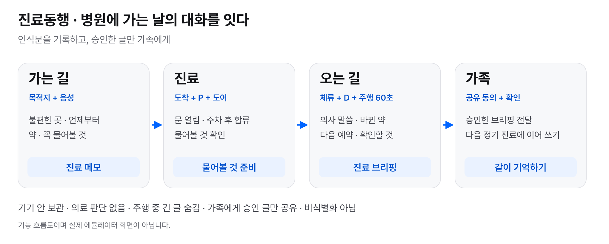

# 진료동행 — 기획서 02 앱 프로젝트 소개 / 심사 자료

> 접수양식(기획서) 02의 본문을 검토용으로 옮긴 사본이다. 제출본은 repo 루트의 `contest-application-consent.docx`이고 `python3 -I tools/plan/build_docx.py`로 다시 만든다. 내용을 고칠 때는 `tools/plan/content.py`를 고친다.

**앱명 / 프로젝트명**: 진료동행

## 1. 앱 한 줄 소개

**진료동행**은 부모님을 모시고 병원에 가는 길에 **물어볼 말을 준비**하고, 오는 길에 **들은 말을 기록해 가족과 나누는** 차량용 진료 기록 앱이다.

## 2. 기획 배경

#### 부모님은 증상을 떠올리고, 자녀는 운전하고, 가족은 결과를 기다린다

정기 진료 날, 어머니는 집에서 하려던 말을 진료실에서 빠뜨린다. 운전하는 자녀는 그 말을 받아 적기 어렵다. 귀가 후에는 동행하지 못한 가족에게 같은 설명을 다시 해야 한다. 이 장면을 해결할 고객 가설로 삼았다. 사용자 조사로 확인한 빈도나 효과 수치는 아직 없다.

| 확인한 근거 | 기획에 주는 의미 |
|---|---|
| 서울 병원안심동행 이용: 649건(2021) → 23,048건(2025) [1] | 병원 이동과 동행을 돕는 수요가 있다. 공공 동행 서비스의 이용 건수이므로 앱 잠재 고객 수와 같지 않다. |
| 외래서비스 응답자 55.0%: 진료시간 5분 미만 [2] | 짧은 대화에서 빠뜨릴 질문을 미리 정리할 이유가 있다. 평균 진료시간을 3분이라고 단정하지 않는다. |
| 투석 동행: 2,658건(2022) → 5,382건(2024) [3] | 병원 동행은 반복되는 생활 일정이다. 지난번 메모와 다음 확인 사항을 이어 쓴다. |
| 병원동행 4,928건 · 사전상담 5,257건(경기도, 2025년 10월 말) [5] | 이동 동행과 사전 안내는 서로 다른 수요다. 차 안에서는 방문 전 질문 준비에 집중한다. 건수는 고유 이용자 수가 아니다. |
| 서울 건강동행: 의료진 설명 전달·의사소통 보조 포함 [6] | 동행은 이동 지원에 그치지 않는다. 들은 말을 정리하고 가족에게 전달하는 기능의 방향을 뒷받침한다. |
| 65세 이상 인구 비중: 20.3%(2025) [4] | 고령 부모와 보호자가 함께 쓰는 인터페이스를 설계한다. 인구 전체를 시장 규모로 계산하지 않는다. |

출처와 열람일은 7번에 모았다. 이용 건수는 [1] 기사의 수치다.

#### 차가 함께 듣고, 이동의 앞뒤를 연결한다

차 안은 부모와 자녀가 함께 있는 대화 공간이다. 병원 목적지, 기어, 동승석 도어 신호를 이용하면 준비·하차·귀가의 시점을 구분할 수 있다. 휴대폰 메모를 여는 일을 운전자에게 요구하지 않고, 짧은 질문과 대답으로 기록을 만든다. 돌봄 인력을 대신하거나 의료진을 평가하는 서비스는 아니다.

## 3. 앱 주요 기능 및 차량 특화 요소

병원 이동의 앞뒤를 같은 방문 기록으로 잇는다. 그림 1은 여정, 그림 2는 기록을 만드는 구조다.

*그림 1. 가는 길 → 진료 → 오는 길 → 가족. 진료 전후의 대화를 같은 방문 기록으로 잇는다.*

| 기능 | 사용자에게 | 차량이라서 가능한 이유 · 신호와 API |
|---|---|---|
| 병원 가는 길 감지 | 병원 목적지에서 준비를 제안한다. 직접 “병원 가는 길”로 시작할 수도 있다. | NaviHelper.getDestinationInfo(), DestinationInfo.name. 등록 병원 또는 병원 이름의 키워드를 확인한다. |
| 가는 길 음성 인터뷰 | 불편한 곳·시작 시점·양상·약·질문을 차례로 기록한다. 원문을 그대로 남긴다. | Pleos TextToSpeech.speak(), SpeechToText.request(). 차의 마이크·스피커로 질문하고 답한다. |
| 주행 중 짧은 화면 | 현재 질문·듣는 중·진행도만 본다. 긴 메모와 입력은 주차할 때 연다. | CarUxRestrictions와 기어 P를 함께 확인한다. 신호를 모르면 제한한다. |
| 정문 하차·합류 | 내려 드리고 주차한 뒤 합류한다. 가족 화면의 “나왔어”를 차에서 듣는다. | 내비 도착 + P + 동승석 도어 열림. Door.registerDoorPosition(), DoorArea(ROW_1_RIGHT). 지원 영역을 먼저 확인한다. |
| 오는 길 브리핑 | 들은 말·약 변경·다음 예약·주의 말씀·다음 질문을 정리한다. | 병원에 머문 뒤 P→D 출발로 귀가 대화를 제안한다. 기어는 pleos-kit의 AAOS CarState로 읽는다. |
| 가족에게 전달 | 보낼 내용을 확인한 뒤 가족 화면에 공유한다. 원문 전체와 위치는 보내지 않는다. | 차에서 읽어 준 결과를 음성으로 승인한다. FamilyLink 포트와 노트북의 HTTP relay를 연결한다. |
| 정기 진료 이어 쓰기 | 같은 병원의 지난 질문과 약 변경을 다시 묻는다. 예약일에 차가 켜지면 안내한다. | 기기 안 방문 기록과 날짜를 사용한다. 좌표가 저장된 병원만 NaviHelper.requestRoute(RouteInfo)로 안내한다. |

#### 반드시 지키는 원칙

> **의료 판단 없음.** 진단·중증도 분류·처방·용량 조언을 만들지 않는다. 각 기록은 발화 ID와 원문으로 추적한다. 불편을 호소하면 고정 안내만 말한다. 응급 도움을 명시적으로 요청한 경우에만 고정 도움 안내를 한다.
>
> **민감정보는 따로 동의.** 첫 인터뷰 전에 별도 음성 동의를 받는다. 전체 화면 안내와 터치 동의는 주차 중에 제공한다. 앱 전용 기기 저장소에 보관한다. 기본 180일, 설정한 기간이 지나면 정리한다. 전체 삭제와 동의 철회를 제공한다. 호칭만 사용한다. [설계값: Policy·Settings]
>
> **가족 공유도 따로 동의.** 연결 동의와 메모·브리핑별 전송 확인을 모두 받는다. 승인한 글과 정문·주차 상태만 보낸다. 대화 원본과 위치는 보내지 않는다. 시연 relay는 메모리 보관 후 24시간에 만료한다. [설계값: relay]
>
> **LLM은 선택.** 기본은 꺼짐이며 고정 서식만으로 결과를 완성한다. ON_DEVICE 문장 정돈도 8초 안에 끝나지 않거나 검사에 실패하면 원문 서식으로 돌아간다. 문자·숫자 토큰의 순서와 내용이 같아야 하고 신체 표현을 보존한다. 문장부호·띄어쓰기만 정리하며 길이는 원문의 1.5배 이하로 제한한다. [설계값: safePolish·PolishGuard]

위 기능은 소스 구현을 기준으로 설명했다. 실제 차량·에뮬레이터 검증과 제품 확장은 5번에서 구분한다. HTTP relay는 로컬 시연용이다. 외부 배포에는 HTTPS와 사용자 인증이 필요하다.

## 4. 주요 사용 시나리오

#### 어머니 정기 진료가 있는 아침

아래 시간과 대화는 허구의 시연 예시다. 병원명은 “○○대학교병원”, 호칭은 “어머니”만 쓴다.

| 장면 | 부모·자녀의 행동 | 앱의 동작 |
|---|---|---|
| 08:30 · 출발 전 | 어머니가 민감정보 안내를 듣고 동의한다. 자녀는 가족 공유를 별도로 설정한다. | 동의 시점을 저장한다. 주차 화면에서 동의 안내와 선택을 제공한다. |
| 가는 길 | “무릎이좀아프”, “사흘전부터”, “계단 올라갈때 더 그래”라고 답한다. | 질문별 원문을 보존한다. 묻고 싶은 말을 더 받는다. 모르면 넘기고, 대답이 없으면 한 번 다시 묻는다. |
| 09:00 · 정문 | P로 정차해 어머니를 내려 드린다. “주차 후 합류”를 선택한다. | 도착·기어·도어 신호로 하차를 확인한다. 승인한 메모만 가족 화면에서 볼 수 있다. |
| 진료 중 | 동행한 가족이 메모의 “물어볼 것”을 확인한다. 진료 뒤 가족 화면에서 “나왔어”를 누른다. | 차는 진료실을 녹음하지 않는다. 수신한 합류 상태를 음성으로 알린다. |
| 10:00 · 돌아오는 길 | “검사 결과는 다음 진료 때 같이 보자고 하셨어”, “2주 뒤 오전 10시”라고 전한다. | 진료 후 대화를 고정 항목에 담는다. 상대 날짜를 정리하되 모호하면 확인 필요로 남긴다. |
| 브리핑 확인 | 내용을 듣고 “네”라고 답해 가족에게 보낸다. | 승인한 브리핑만 공유한다. 다음 진료의 확인할 말과 예약을 기기에 남긴다. |

진료 전 질문 제안은 누적 주행 60초 뒤 또는 주차 중 시작한다. 귀가 제안은 병원 도착 뒤 15분 이상 머문 후 D로 출발할 때 한다. 두 값은 의료 기준이 아닌 오작동을 줄이기 위한 제품 설계값이다. 출처: Policy.SAFE_DRIVE_MS·STAY_MS.

## 5. 개발 계획

#### 판단 로직은 순수 Kotlin, 차량 연결은 pleos-kit

`visit-core`의 `VisitCore`는 하나의 이벤트 큐로 상태를 소유한다. `VisitMachine`은 이벤트를 받아 상태와 실행할 작업을 만든다. 저장은 외부 작업보다 먼저 완료한다. 느린 음성·통신·LLM 호출은 별도 작업으로 실행하고 응답 ID로 현재 질문과 맞춘다. 삭제·동의 철회 후 늦게 온 결과는 폐기한다.

| 층 | 구현 범위 |
|---|---|
| 순수 Kotlin core | 방문 상태, 원문 슬롯, 한국어 응답·날짜 해석, 동의·보관 정책, 브리핑 서식, PolishGuard. Android SDK 없이 JVM 테스트 가능. |
| 포트 | Repository · SpeechPort · FamilyLink · Polisher · Navigator. 시간은 주입한다. 파일·SDK·네트워크 없이 상태 전이를 검증한다. |
| Android app | Compose 화면 + VisitService 전경 서비스 + VoiceAgent + HttpFamilyLink. 앱은 SDK를 직접 호출하지 않고 pleos-kit을 사용한다. |
| 저장·복구 | AtomicRepository: 임시 파일 후 원자 교체. 재시작하면 진행 중 인터뷰를 주차 화면에서 이어가거나 폐기한다. 저장 실패 때 인터뷰를 멈춘다. |
| 가족 relay | Python 표준 라이브러리 HTTP 서버. 임의 토큰으로 연결하고 승인된 글과 상태만 보관한다. 만료·삭제·잘못된 요청을 검사한다. |

*그림 2. 고정 질문 → 발화 원문과 ID → 서식 기록. LLM은 선택이며 검사를 통과한 문장 정돈만 채택한다.*

#### 레퍼런스에서 확인한 SDK/API

| API 이름 | 용도 · 연결 방식 |
|---|---|
| NaviHelper.getDestinationInfo() / DestinationInfo.name | 목적지의 병원 이름과 좌표. pleos-kit의 NaviKit → VisitNaviKit에서 core용 값으로 변환. |
| NaviHelper.requestRoute(routeInfo: RouteInfo) | 사용자가 승인하고 저장 좌표가 있을 때 길안내. 병원 POI 검색 기능은 제공하지 않는다. |
| Door.checkDoorPositionCapabilities() / registerDoorPosition(area, listener) | DoorArea(DoorValue.ROW_1_RIGHT)의 읽기 지원을 확인한 후 동승석 도어 상태 구독. 문을 자동 조작하지 않는다. |
| SpeechToText.request() / TextToSpeech.speak(text, isFinal) | ON_DEVICE 음성 입력·출력. TTS 종료 후 STT를 시작하며 onReady 뒤에만 듣는 시간을 센다. |
| LLM.generateContent(prompt, listener) / Mode.ON_DEVICE | 선택적 문장 정돈. 실패·시간 초과·원문 검사 탈락 때 서식 결과로 대체. |
| AAOS: VehiclePropertyIds.GEAR_SELECTION / PERF_VEHICLE_SPEED | pleos-kit CarState로 기어·속도 읽기. CarUxRestrictions와 독립 화면 watcher로 주행 중 상세 표시 차단. |

#### 검증과 기술 PT 시연

코어 테스트는 가상 시간으로 병원 감지, 동의 차단, 묻기·재질문·건너뛰기, 날짜 해석, 방문 연속성, 하차·귀가, 공유 승인, 삭제·만료·복구, LLM 검사를 확인한다. 앱 테스트는 화면 제한과 release 인텐트 입력 범위를 확인한다. relay는 HTTP 계약과 만료를 검증한다. 측정 결과 파일에서 집계하지 않은 테스트 개수는 쓰지 않는다.

시연 환경: Pleos Connect Emulator v2.1.0 / API 34 / 2560×1440. 세로 분할 화면도 확인한다. `demo=visit`은 실제 TTS와 허구 scripted STT를 쓴다. “시연: 미리 녹음한 대답” 표시는 녹음 파일이나 마이크 검증을 뜻하지 않는다. Virtual Console의 실제 P·도어·D 입력으로 하차·귀가 전이를 시연한다. [환경: CLAUDE.md·시연 코드]

## 6. 기대효과 및 발전 가능성

#### 첫 고객은 정기 진료에 부모님을 모시는 운전자

부모는 말씀을 정리하고, 운전자는 받아 적는 부담을 줄이며, 동행하지 못한 가족은 확인한 기록을 받는다. 기대효과는 질문 누락과 반복 전달의 감소다. 진료 결과 개선, 진료시간 단축, 의료비 절감은 아직 측정하지 않았으므로 약속하지 않는다. [1]~[6]은 문제의 배경이며 제품 효과의 증거는 아니다.

#### 예상 MAU는 보급량을 가정한 작은 도입 모형

아직 Pleos 차량 보급량, 동행 가구 비율, 설치 전환율의 검증된 값을 확보하지 못했다. 아래는 출시 예측이 아닌 **검증할 가정**이다. MAU는 월 1회 이상 진료 준비 또는 귀가 기록을 완료한 운전자 수로 정의한다. 같은 가족과 같은 사용자의 반복 방문은 중복 계산하지 않는다.

| 항목 | 기준 가정 | 계산·확인 방법 |
|---|---|---|
| 도달 가능한 운전자 | 10,000명 | 초기 차량 채널의 도달 모수 가정. [5]의 11개 시군은 실증 채널 탐색 근거일 뿐, 제휴·차량 이용자 수를 확보한 것은 아니다. |
| 정기 동행 수요 | 10% | 대상 1,000명. 수요 존재는 [1][3][5]로 확인했지만 10%는 관측값이 아니다. 대상 운전자 설문으로 확인한다. |
| 설치·동의 전환 | 20% | 시작 사용자 200명. 전환율을 뒷받침할 외부 근거는 없다. 설치·별도 동의 완료 비율로 검증한다. |
| 월 실제 사용 | 50% | 예상 MAU = 10,000 × 10% × 20% × 50% = 100명. [3]은 반복 방문의 근거이며 50%는 실측이 아닌 가정이다. |
| 민감도 | 도달 모수 5,000~20,000명 | 나머지 가정이 같으면 MAU 50~200명. 확보한 고객 수나 시장 예측치가 아니다. |

#### Retention은 방문 주기로 잰다

매일 쓰게 만드는 앱이 아니다. 정기 진료 때 지난번 확인할 말을 불러오는 것이 재사용 이유다. [3]의 반복 동행 수요는 이 방향의 근거다. 다음 달 재사용률과 다음 예정 진료에서의 재사용률을 따로 측정할 계획이다. 후자는 다음 방문 시점이 지난 사용자 중 다시 기록을 완료한 사용자 비율로 정의한다. 현재 측정값이나 목표 달성률은 없다. [6]의 월 최대 10회는 서비스 한도이므로 평균 방문 횟수나 앱 재사용률로 쓰지 않는다.

#### 확장은 예약·보호자·공공 동행으로

| 확장 계획 | 사업 가설과 검증 과제 |
|---|---|
| 병원 예약 연동 | 동의를 받아 예약을 가져오면 날짜를 다시 말하는 부담이 줄어든다. 병원별 API·계약·접근 권한은 미확보다. |
| 보호자 앱 | 차 밖에서도 승인된 메모와 방문 기록을 확인한다. 현재 모바일 웹 relay를 사용성 검증의 출발점으로 삼는다. |
| 지자체 동행 서비스 B2G | [5]의 지역 운영기관과 [6]의 설명 전달 업무를 실증 대상으로 탐색한다. 동행매니저의 방문 전 준비·가족 전달을 돕는 도구로 제안한다. 기관 단위 운영료를 사업 가설로 검토하되 단가·계약·고객은 미정이다. |

민감한 진료 내용을 광고나 데이터 판매에 쓰는 수익모델은 채택하지 않는다. 실증에서는 별도 동의 아래 사용 완료·재사용 같은 최소 집계만 검토한다. 현재 분석 서버는 구현하지 않았다.

## 7. 참고자료

**구현 자료와 화면** · 기능 흐름도, 인터뷰 구조도, 구현·테스트와 실제 에뮬레이터 캡처를 함께 제공한다.

| 자료 | 파일 · 내용 |
|---|---|
| 시연 영상 | `docs/demo/jinryo-donghaeng-demo.mp4` · 2분 14초. Pleos Connect Emulator·Virtual Console 화면 녹화와 자막, 소리 없음. 별도 동의 → 가는 길 음성 인터뷰 → 정문 하차·진료 메모 → 가족 공유 동의 → 오는 길 브리핑 → 기록 완료와 가족 답장. |
| 실행 파일 | `apk/` 폴더의 release APK. 설치·시연 절차는 README에 안내한다. |
| 구현·구조·이용 조건 | `visit-core`, `app`, `pleos-kit`, `tools/family`, `docs/ARCHITECTURE.md`. 이용 조건과 고지는 `LICENSE`, `NOTICE.md`에 정리했다. |

#### 확인한 자료와 출처

모든 웹 자료는 2026-11-15에 본문을 실제 열람했다. 아래는 확인한 사실의 요약이며 원문을 복제하지 않았다.

| 번호 · 자료 / 게시일 | 확인한 사실 · URL |
|---|---|
| [1] 한국경제 · 병원동행·돌봄 서비스 보도 (네이트 전재본) 2026-07-22; 수정 07-27 | 서울 병원안심동행 2021년 649건 → 2025년 23,048건. 이용 건수이며 이용자 수가 아니다. https://news.nate.com/view/20260722n02018 |
| [2] 연합뉴스 · 2023 의료서비스 경험조사 보도 2024-07-24 | 외래서비스 응답자 55.0%가 진료 5분 미만. 전체 평균은 8.0분. 조사 대상 14,910명. https://www.yna.co.kr/view/AKR20240723135000530 |
| [3] 서울특별시 · 병원안심동행 서비스 이용 개선 2025-02-28 | 투석 동행 2022년 2,658건 → 2024년 5,382건. 정기 이용과 보호자의 일·돌봄 병행 사례. https://news.seoul.go.kr/welfare/archives/568479 |
| [4] 통계청 · 2025 고령자 통계 (국가데이터처 게시) 2025-09-29 | 2025년 65세 이상 인구 비중 20.3%. 차량 이용자나 앱 고객 비중으로 환산하지 않는다. https://mods.go.kr/board.es?act=view&bid=10820&list_no=438832&mainXml=Y&mid=a10301010000 |
| [5] 경기도 · 1인가구 병원안심동행 이용실적 2025-12-10 | 2025년 10월 말: 병원동행 4,928건, 사전상담 5,257건. 11개 시군 운영. 상담을 동행 건수에 합치지 않는다. https://gnews.gg.go.kr/briefing/brief_gongbo_view.do?BS_CODE=s017&number=68642&subject_Code=BO01 |
| [6] 서울특별시 · 동행서비스 전면 확대 2026-04-12 | 건강동행에 의료진 설명 전달·의사소통 보조 포함. 월 최대 10회는 이용 한도이며 실제 이용 빈도가 아니다. https://www.seoul.go.kr/news/news_report.do?nttNo=456058&srchCtgry=475 |

기술 자료: 제공된 Pleos SDK/API 레퍼런스의 NaviHelper, Vehicle, SpeechToText, TextToSpeech, LLM 명세와 Pleos 주행 제한 가이드. 구현 근거: `visit-core`, `pleos-kit`, `app`, `tools/family`, `docs/ARCHITECTURE.md`. 제품 임계값은 `docs/product/SPEC.md`와 코드의 Policy·Settings를 기준으로 했다.

*그림 3. 실제 에뮬레이터 캡처*

## 8. 숏폼 링크

제출하지 않음.
